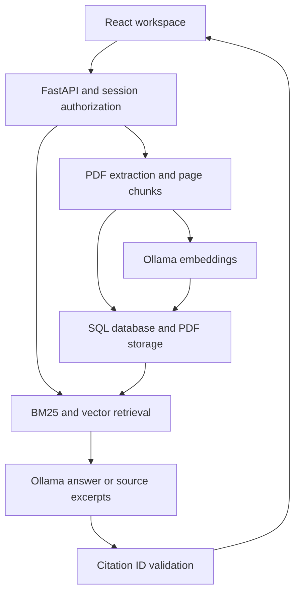

# CiteWise

**Your documents. A clearer picture.**

A full-stack PDF research workspace with page-level citations, local retrieval-augmented generation (RAG), document comparison, and saved conversations. Built with React + TypeScript, FastAPI, SQLAlchemy, PostgreSQL/pgvector, and Ollama. SQLite is available for a lightweight local setup.

## What works

- Register and sign in to an isolated personal workspace.
- Upload text-based PDFs; extract page-aware chunks with overlap.
- Search all documents or a selected subset.
- Read source excerpts without any model or API key.
- Enable local Ollama embeddings and AI answers with validated citation IDs.
- Combine BM25 keyword retrieval and semantic retrieval using reciprocal rank fusion.
- Compare two or three documents, reserving evidence from each document.
- Open citations in a PDF preview at the original page.
- Restore/delete conversations and export them as Markdown.
- Reindex documents after enabling Ollama; duplicate and scanned PDFs receive actionable errors.
- Delete PDFs and the saved turns that contain their excerpts.

**Two explicit modes:** `excerpt` returns matching passages verbatim. It does not pretend to generate an AI answer. `ollama` performs semantic retrieval and writes an answer using a local model. If the provider fails or returns invalid citations, the UI labels the fallback as source excerpts.

## Quick start: Docker Desktop

From this project folder:

```sh
docker compose up --build -d
```

Open **http://localhost:8000** and create an account. No default account or password is installed. The default runs in excerpt mode with PostgreSQL/pgvector. Upload the two PDFs in `samples/` to try it.

Ask: **What is the HDFS replication factor?** Then open source 1: it should point to PDF page 2 of `distributed-systems-notes.pdf`.

### Enable local AI

1. Copy `.env.example` to `.env` and set `AI_MODE=ollama`.
2. Start the optional model service and download the two models:

```sh
docker compose --profile ai up --build -d
docker compose exec ollama ollama pull nomic-embed-text
docker compose exec ollama ollama pull llama3.2:3b
```

3. Upload PDFs, or click **Reindex for semantic search** on documents uploaded earlier.

Model downloads require internet access and several GB of disk space. Inference speed and memory needs depend on your machine. The supplied Compose service uses CPU by default. Models run locally; no paid API key is needed. The application's AI mode badge reports configuration, not a guarantee that Ollama is currently reachable; provider errors are displayed in the answer.

To stop the app while keeping data: `docker compose --profile ai down`. Do not add `-v` unless you intend to erase stored data and models.

## Local development without Docker

Prerequisites: Python 3.12, Node.js 22+, npm. Run commands from the project root.

### Windows PowerShell

```powershell
python -m venv .venv
.\.venv\Scripts\python -m pip install -r backend/requirements.txt
npm --prefix frontend ci
npm --prefix frontend run build
.\.venv\Scripts\python -m uvicorn app.main:create_app --factory --app-dir backend --host 127.0.0.1 --port 8000
```

### macOS / Linux

```sh
python3 -m venv .venv
.venv/bin/python -m pip install -r backend/requirements.txt
npm --prefix frontend ci
npm --prefix frontend run build
.venv/bin/python -m uvicorn app.main:create_app --factory --app-dir backend --host 127.0.0.1 --port 8000
```

Open **http://localhost:8000**. Local development defaults to SQLite, stored under `data/`. The backend serves the built frontend from the same origin.

For local AI without Docker, install [Ollama](https://ollama.com/), pull the same two models, and create `.env` with `AI_MODE=ollama`. Restart the backend. `.env` is read at startup; existing environment variables take precedence.

For frontend hot reload, set `APP_ORIGIN=http://localhost:5173` in `.env`, restart the backend, and run `npm --prefix frontend run dev` in another terminal. Open port 5173; Vite proxies `/api` to port 8000. Use the exact host in `APP_ORIGIN` (`localhost` and `127.0.0.1` are different origins).

## Configuration

| Variable | Default | Purpose |
| --- | --- | --- |
| `DATABASE_URL` | `sqlite:///./data/citewise.db` | SQLAlchemy database URL; Compose sets PostgreSQL |
| `DATA_DIR` | `./data` | Uploaded PDF storage |
| `AI_MODE` | `excerpt` | `excerpt` or `ollama` |
| `OLLAMA_URL` | `http://localhost:11434` | Server-controlled model endpoint |
| `CHAT_MODEL` | `llama3.2:3b` | Local answer model |
| `EMBED_MODEL` | `nomic-embed-text` | Embedding model |
| `EMBED_DIM` | `768` | Expected vector length |
| `APP_ORIGIN` | `http://localhost:8000` | Accepted browser origin for write requests |
| `COOKIE_SECURE` | `false` | Set `true` behind HTTPS |
| `POSTGRES_PASSWORD` | Development-only value | Compose database password; change for deployment |

Embedding inputs use `search_query:` / `search_document:` prefixes for the default Nomic model. If changing model families, adapt the prefix convention in `backend/app/ai.py` and reindex every document. Changing dimensions requires reindexing as well. Keep one embedding model/dimension configuration per database.

## Tests and evaluation

```sh
# Inside the Python environment:
python -m pytest -q
python scripts/create_samples.py
python scripts/evaluate.py

# With the backend running and APP_ORIGIN=http://127.0.0.1:8000:
cd frontend
npx playwright install chromium
npm run test:e2e
```

The API tests cover authorization, session handling, PDF errors, citations, filtering, comparison, deletion, provider contracts, and graceful fallback. Browser tests exercise real registration, upload, answering, citation preview, history, export, deletion, and mobile layout.

`docs/evaluation.json` contains a reproducible **six-question synthetic retrieval smoke benchmark**, not a claim about general accuracy or LLM quality. Live Ollama inference and Docker/PostgreSQL integration require the respective local services; mocked provider tests do not replace those checks. See [validation notes](docs/VALIDATION.md).

GitHub Actions runs the Python tests, builds the frontend, and runs Chromium smoke tests on push/PR. Its remote run status is independent of local results.

## Architecture



See [architecture and tradeoffs](docs/ARCHITECTURE.md) and [interview/demo notes](docs/DEMO.md).

## Scope and limitations

This is a complete local portfolio application, not a hardened public SaaS deployment. Current bounds: 30 PDFs per user, 20 MB and 200 pages per PDF, 1,500 chunks per document. Only selectable PDF text is supported; OCR, image interpretation, and reliable table extraction are not implemented. Questions are independent: saved history is not used as model context.

Retrieval thresholds are heuristics. An unrelated passage can still match a keyword, and a relevant passage can be missed. Valid citation IDs ensure a link points to retrieved evidence; they do **not** prove every generated claim is entailed by that evidence. The model can still make mistakes.

Ingestion and AI requests are synchronous. Authentication throttling and ingestion locking are per process. BM25 is computed over the selected corpus in memory; PostgreSQL vector search is exact rather than approximate. For a larger deployment, add background workers, distributed rate limiting, document quotas, an ANN index, migrations, monitoring, and load testing.

Before exposing the app publicly, deploy behind HTTPS, set secure cookies and the correct origin, replace the development database password, apply proxy-level upload/rate limits, restrict signup as needed, and use a resource-isolated PDF parsing worker. Back up both the database and uploaded-PDF volume. There is no password-reset/email flow in this version.

## Reference documentation

- [FastAPI file uploads](https://fastapi.tiangolo.com/tutorial/request-files/)
- [Ollama embedding API](https://docs.ollama.com/api/embed)
- [Ollama chat and structured outputs](https://docs.ollama.com/api/chat)
- [pgvector SQLAlchemy integration](https://github.com/pgvector/pgvector-python)

No personal documents, passwords, `.env` files, model weights, or runtime database are part of the repository.
